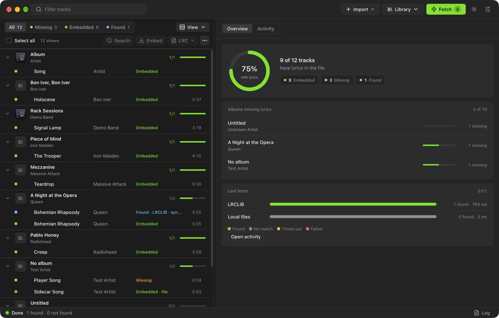

<div align="center">
  
  <h1 align="center">LYRIXEARCH</h1>
  <p align="center"><strong>Find lyrics for your music, review them, and embed them in the files.</strong></p>
  <p align="center">One Rust engine behind a CLI, a terminal UI and a desktop app. Drop a folder; it scans every subfolder, searches many sources at once, matches the results to your tracks and writes the lyrics into the tags.</p>
<p align="center">
  <a href="https://www.rust-lang.org/"><picture>
    <source media="(prefers-color-scheme: dark)" srcset="https://shieldcn.dev/badge/Rust.svg?variant=outline&amp;size=default&amp;mode=dark&amp;logo=rust&amp;logoColor=5fe27f" />
    
  </picture></a>
  <a href="https://tauri.app/"><picture>
    <source media="(prefers-color-scheme: dark)" srcset="https://shieldcn.dev/badge/Tauri.svg?variant=outline&amp;size=default&amp;mode=dark&amp;logo=tauri&amp;logoColor=5fe27f" />
    
  </picture></a>
  <a href="https://ratatui.rs/"><picture>
    <source media="(prefers-color-scheme: dark)" srcset="https://shieldcn.dev/badge/ratatui.svg?variant=outline&amp;size=default&amp;mode=dark&amp;logo=ratatui&amp;logoColor=5fe27f" />
    
  </picture></a>
  <a href="LICENSE"><picture>
    <source media="(prefers-color-scheme: dark)" srcset="https://shieldcn.dev/badge/MIT.svg?variant=outline&amp;size=default&amp;mode=dark&amp;logo=lu%3AScale&amp;logoColor=5fe27f" />
    
  </picture></a>
</p>
<p align="center">
  <a href="#status"><picture>
    <source media="(prefers-color-scheme: dark)" srcset="https://shieldcn.dev/badge/macOS.svg?variant=outline&amp;size=default&amp;mode=dark&amp;logo=apple&amp;logoColor=5fe27f" />
    
  </picture></a>
  <a href="#status"><picture>
    <source media="(prefers-color-scheme: dark)" srcset="https://shieldcn.dev/badge/Linux.svg?variant=outline&amp;size=default&amp;mode=dark&amp;logo=linux&amp;logoColor=5fe27f" />
    
  </picture></a>
  <a href="#status"><picture>
    <source media="(prefers-color-scheme: dark)" srcset="https://shieldcn.dev/badge/Windows.svg?variant=outline&amp;size=default&amp;mode=dark&amp;logo=ri%3AFaWindows&amp;logoColor=5fe27f" />
    
  </picture></a>
</p>

  <p align="center">
    <a href="#quick-start">Quick Start</a> |
    <a href="#install">Install</a> |
    <a href="#app">App</a> |
    <a href="#tui">TUI</a> |
    <a href="#sources">Sources</a> |
    <a href="#plugins">Plugins</a> |
    <a href="#functionality">Functionality</a> |
    <a href="#structure">Structure</a> |
    <a href="#build">Build</a> |
    <a href="#contributing">Contributing</a> |
    <a href="#license">License</a>
  </p>
</div>

<p align="center">
  
  <br>
  <sub>The macOS desktop app in Albums view, showing a demo library.</sub>
</p>

---

##  Quick Start

```bash
# 1. get it: build from source (or grab a build from Releases)
cargo build --release                    # target/release/lyrixearch  +  lyrixearch-gui

# 2. see what is missing, then fill it in
lyrixearch scan ~/Music -r               # what is there, what has no lyrics
lyrixearch fetch ~/Music -r --dry-run    # search, change nothing
lyrixearch fetch ~/Music -r              # search and embed where missing

# 3. or just open the interface
lyrixearch                               # terminal UI (no arguments)
lyrixearch-gui                           # desktop app
```

> [!TIP]
> Run `lyrixearch` with no arguments for the **terminal UI**. Searching never writes by itself there: review the results, then press `w`.

##  Install

Download a build from [Releases](../../releases) (macOS, Windows, Linux), or build it yourself below.

> [!NOTE]
> Release builds are **unsigned**. On macOS right-click the app and choose Open the first time, or run `xattr -dr com.apple.quarantine Lyrixearch.app`. On Windows choose "More info, Run anyway" in SmartScreen.

To run the CLI from anywhere, link it onto your `PATH`:

```bash
ln -s "$PWD/target/release/lyrixearch" ~/.local/bin/lyrixearch
```

##  App

| | Feature |
| --- | --- |
|  | **Add music** by dropping folders or files on the window (or the app icon on macOS), **Files** / **Folder**, or the command line. Every subfolder is scanned. **Library** remembers folders and re-scans them in one go. |
|  | **Track list** with cover art, duration and a colored lamp per state. Filter by **All, Missing, Embedded, Found, No match, Failed**. Use **View** to sort or switch between **Comfortable**, **Compact** and **Albums**. |
|  | **Fetch**: the green top-bar button searches the listed tracks and embeds what it finds. A **Replace existing** switch decides whether tracks that already have lyrics are searched too. |
|  | **Files menu**: format **Auto / .lrc / .txt**, then **Embed from file** (the file named like the track) or **Write to file**. |
|  | **Right pane**: select a track to see its player and **Lyrics**, **Edit**, **Web** and **Details** tabs. With no track selected, **Overview** shows lyrics coverage and **Activity** shows fetch progress and results. |
|  | **Web search** inside the window (Google, Bing, DuckDuckGo, Yahoo, Yandex, Brave AI) in phone layout so pages fit; Google AI Mode opens in your own browser. On Linux all results open in your browser. |

<details>
<summary><strong>State colors</strong></summary>

| Lamp | Meaning |
| --- | --- |
|  green | lyrics embedded |
|  amber | missing lyrics |
|  blue | found, not embedded yet |
|  purple | **No match**: no source had them |
|  red | **Failed**: the search could not finish |

</details>

##  TUI

Run `lyrixearch` with no arguments.

| Key | Action | Key | Action |
| --- | --- | --- | --- |
| `a` | add folder | `w` | write found lyrics |
| `space` | mark | `e` | edit in `$EDITOR` |
| `s` / `S` | search marked or current / all shown | `d` | delete embedded lyrics |
| `l` | embed the `.lrc`/`.txt` beside the track | `o` | show in the file manager |
| `b` | web search in browser | `f` | filter (all / without / with lyrics) |
| `/` | find | `t` / `x` | tags on-off / sidecar mode |
| `?` | help | `q` | quit |

The filter bar counts tracks by state (Missing, Embedded, Found, Not found, Error). While a search runs, the status line shows the progress, the current track and source, and how many were found. Right-click a track (or a selection) for Search, Embed, LRC and TXT files, Copy lyrics, Show in Finder, Copy file path, Remove from list and Delete lyrics.

Settings live in `~/.config/lyrixearch/config.toml` (or `$XDG_CONFIG_HOME/lyrixearch`; `%APPDATA%\lyrixearch` on Windows). The app and the CLI share that file: a change in one is used by the other.

<details>
<summary><strong>CLI</strong></summary>

| Command | What it does |
| --- | --- |
| `scan <paths> [-r]` | list tracks and which lack lyrics |
| `fetch <paths> [-r] [--dry-run] [--overwrite] [--synced] [--sidecar off\|auto\|lrc\|txt] [--keep-mtime\|--no-keep-mtime]` | search and embed |
| `embed-files <paths…> [--overwrite] [--dry-run]` | embed the `.lrc`/`.txt` beside each track (an `.lrc` fills the synced field too) |
| `show <file>` / `remove <paths…> [--yes]` | print or delete embedded lyrics (`remove` needs `--yes` without a terminal) |
| `set <file> [--from lyrics.lrc]` | embed lyrics you supply, from a file or stdin (timed lyrics keep their timing) |
| `export <paths…> [-r] [--format auto\|lrc\|txt] [--overwrite]` | save embedded lyrics to a `.lrc`/`.txt` beside each track |
| `providers [--test]` | list sources, optionally health-check them |
| `plugins list\|install\|enable\|disable\|test\|path` | manage plugins (`install` also enables) |
| `config show\|get\|set\|path\|reset` | settings (TOML) |

`--json` on `scan`, `fetch`, `embed-files`, `export`, `remove`, `providers` and `plugins list` prints one JSON object per line on stdout, for scripts.

</details>

##  Sources

| Source | Notes |
| --- | --- |
| `local_files` | `.lrc` / `.txt` next to the track or in a `Lyrics/` folder |
| `genius` | plain lyrics from the public song page |
| `lrclib` | open database, **synced** lyrics |
| `azlyrics` | plain lyrics, large English catalogue (its captcha is answered in the desktop app) |
| `letras` | large catalogue, strong for Portuguese and Spanish music (pages load in the desktop app's browser) |
| `lyricsfreak` | plain lyrics |
| `darklyrics` | metal lyrics, album pages (plain http only) |
| `ddg_search` | web-search fallback: finds a page one of the scrapers understands |
| `bandcamp` | lyrics the artist published on the track page |
| `lyrics_ovh` | exact-name API |

Per track, sources are tried in order, each with one time budget for the track; sources that keep failing, or that ask to slow down, are skipped for a while. A title that finds nothing is retried without trailing brackets, and a "Various Artists" track with its album artist. Tracks whose names are placeholders ("Track 01", "Unknown Artist") are only matched against lyrics files next to them. With a Last.fm API key set (`lastfm_api_key`), misspelled artist and title names are corrected before searching. Ten tracks are searched at once by default. Sites that show a captcha or bot check (DuckDuckGo, AZLyrics, anything behind Cloudflare) are loaded in a hidden browser inside the desktop app; when a check needs a person, the status line offers Verify, and the rest of the search reuses the pass. DuckDuckGo is asked at most once every 2.5 seconds. The CLI has no browser, so it reports those sites and moves on. Not included: Musixmatch, Spotify and Apple Music, whose lyrics need a private app token or a signed-in account.

##  Plugins

A plugin is any script that speaks a small JSON protocol over stdin/stdout. See [docs/PLUGINS.md](docs/PLUGINS.md). `plugins/metallum` is an example; it needs the separate `metallum` command-line tool.

##  Functionality

Plain lyrics go to ID3v2 `USLT`, MP4 `©lyr`, Vorbis/FLAC `LYRICS`, ASF `WM/Lyrics` and APE; synced lyrics also go to ID3v2 `SYLT` (MP3) and `SYNCEDLYRICS` (FLAC, Ogg, Opus), through [`lofty`](https://crates.io/crates/lofty). Every other tag field and frame is kept as it was, and file modification times are preserved by default. Options: sidecar `.lrc`/`.txt` (an existing sidecar is only replaced with **Replace existing** on), synced lyrics only, title clean-up rules, strip `[Chorus]`-style headers, leading blank line. Found lyrics that have not been embedded yet are kept between runs. Settings live in a TOML file (`lyrixearch config path`) and are all editable in the app.

##  Structure

```text
lyrixearch/
├── crates/
│   ├── core/            # lyrixearch-core: sources, matching, tag writing, engine
│   │   └── src/providers/   # one file per source, plus plugin and web helpers
│   ├── cli/             # lyrixearch: CLI and ratatui terminal UI
│   └── gui/             # lyrixearch-gui: Tauri 2 app
│       ├── src/         #   Rust backend (commands, player, embedded browser)
│       └── ui/          #   HTML/CSS/JS front end, fonts, no build step
├── plugins/metallum/    # example plugin
├── docs/PLUGINS.md      # plugin protocol
├── DESIGN.md            # design system and rationale
└── .github/workflows/   # CI and release builds
```

##  Build

You need a recent stable Rust toolchain.

```bash
cargo build --release
cargo test --workspace
cargo run -p lyrixearch-core --example probe -- "Queen" "Bohemian Rhapsody"   # live check of every source
```

Package the desktop app (`.app`/`.dmg`, `.msi`/`.exe`, `.deb`/`.AppImage`):

```bash
cargo install tauri-cli --version "^2" --locked
cd crates/gui && cargo tauri build
```

<details>
<summary><strong>Platform Prerequisites</strong></summary>

**Linux** needs the Tauri prerequisites, ALSA headers for the built-in player and AppIndicator for the tray icon:

```bash
sudo apt install libwebkit2gtk-4.1-dev libsoup-3.0-dev libjavascriptcoregtk-4.1-dev libgtk-3-dev \
  librsvg2-dev libxdo-dev libssl-dev libasound2-dev libayatana-appindicator3-dev patchelf
```

**Windows** needs the Microsoft C++ build tools; the app uses the system WebView2 runtime.

</details>

### Status

CI builds, lints and tests on macOS, Windows and Linux. Hands-on testing covers **macOS**, and **Linux** on CachyOS with KDE Plasma (Wayland): adding a folder, live search, embedding from `.lrc`, cover art and the player all work there.

- **Linux:** the Web tab opens results in your browser instead of inside the window, because Tauri cannot place a page inside the window on Linux. The verification window for captcha-protected sources opens but has not yet been seen to pass a check there.
- **Windows:** built by CI, not yet tested by hand.

Bug reports with the OS and version are welcome.

##  Contributing

Issues and pull requests are welcome. Run `cargo fmt`, `cargo clippy --workspace --all-targets` and `cargo test --workspace` first; CI runs the same checks.

> [!WARNING]
> Lyrics are copyrighted by their owners. Lyrixearch fetches and embeds them for personal use; respect each source's terms and do not redistribute what you download. Sources can change or block access at any time.

Not affiliated with any other lyrics tool or service.

## <a href="https://opensource.org/license/MIT"></a> License

<div align="center">

[**𝗠𝗜𝗧 𝗟𝗜𝗖𝗘𝗡𝗦𝗘**](https://spoo.me/VTWSoc7)

<a href="https://spoo.me/VTWSoc7"></a>

**𝗖𝗢𝗣𝗬𝗥𝗜𝗚𝗛𝗧 © 𝟮𝟬𝟮𝟲 𝗗𝗘𝗔𝗧𝗛𝗥𝗔𝗦𝗛𝗘𝗗**

</div>
